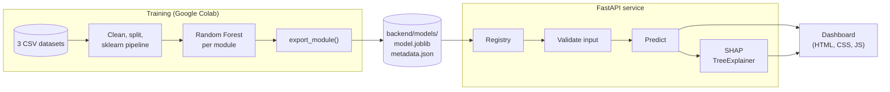

# Field Oracle

**Explainable crop, fertilizer and yield decision support for farm fields.**

Field Oracle puts three machine-learning models behind one web dashboard. Enter your field's soil and weather
conditions and it tells you:

1. **Which crop to grow** (22 crops)
2. **Which fertilizer to apply** (10 fertilizers)
3. **What yield to expect** (with a likely range)

Every prediction comes with a SHAP explanation showing *which inputs drove the result*, so you can judge
whether to trust it.

---

## Highlights

- Three Random Forest models: two classifiers and one regressor
- Full probability ranking for crop and fertilizer, not just the top answer
- Yield estimate with an 80% range, a crop comparison, a temperature response curve and per-input effects
- SHAP explanations for every prediction (one-hot features summed back to the original input)
- FastAPI back end with input validation, readable errors and an automated test suite
- Static dashboard with light and dark themes, saved predictions and CSV export

---

## Quick start

The project has three parts: `backend/` (API and models), `frontend/` (dashboard) and `dataset/`. You run the
backend and the frontend in two separate terminals.

**First time only: install**

```powershell
cd backend
python -m venv venv
venv\Scripts\activate               # Mac/Linux: source venv/bin/activate
pip install -r requirements.txt
```

**Every time: you need two terminals**

Terminal 1, the API (from the project folder):

```powershell
cd backend
venv\Scripts\activate               # Mac/Linux: source venv/bin/activate
uvicorn src.api:app --reload --port 8000
```

Terminal 2, the dashboard (from the project folder):

```powershell
cd frontend
python -m http.server 5500
```

Then open **http://localhost:5500** in your browser.

**Check that it works**

- API health: open http://localhost:8000/api/health. You should see `"crop": true, "fertilizer": true, "yield": true`.
- Interactive API docs: http://localhost:8000/docs
- The status badge in the dashboard sidebar should say "Connected to your models."

**If something goes wrong**

| Problem | Fix |
|---|---|
| `ModuleNotFoundError: No module named 'src'` | You are not inside `backend/`. Run `cd backend`, then run uvicorn again. |
| `/api/health` shows a model as `false`, or requests return 503 | `backend/models/` is missing or empty. It needs the `crop/`, `fertilizer/` and `yield/` folders, each with `model.joblib` and `metadata.json`. |
| Dashboard says it cannot connect | The API is not running, or is on another port. Start Terminal 1, or change `base` in `frontend/js/api.js`. |
| `Address already in use` | Use another port, for example `--port 8001`, and update `base` in `frontend/js/api.js` to match. |
| Warning about scikit-learn versions | Install the version used for training: `pip install scikit-learn==<version in backend/models/*/metadata.json>`. |
| SHAP errors or slow startup | Run without SHAP: `$env:SHAP_ENABLED=0; uvicorn src.api:app --port 8000` (Mac/Linux: `SHAP_ENABLED=0 uvicorn src.api:app --port 8000`). |
| Port 5500 busy | `python -m http.server 5501` and open that port instead. |
| `venv\Scripts\activate` is blocked in PowerShell | Run `Set-ExecutionPolicy -Scope CurrentUser RemoteSigned` once, then try again. |

Stop either server with `Ctrl + C`.

---

## Results

Scores are on held-out test data.

| Module | Task | Test result |
|---|---|---|
| Crop | 22-class classification | Accuracy **0.914**, macro-F1 0.914, top-3 accuracy **0.975** |
| Fertilizer | 10-class classification (imbalanced) | Accuracy **0.911**, macro-F1 0.854, top-3 accuracy 0.973 |
| Yield | Regression | MAE **4.27**, RMSE 6.60, R² **0.936** (mean baseline: MAE 22.2, R² 0.0) |

Details:

- **Crop** uses a stratified 80/20 split (1,760 train, 440 test). A model with all 22 columns scored the same
  accuracy as the 7-feature model, so the simpler one is served.
- **Fertilizer** uses a stratified 80/20 split (2,480 train, 620 test) with balanced class weights. The rarest
  classes are hardest (Gypsum recall about 0.54).
- **Yield** uses a chronological split: train 2014 to 2021, test 2021-12-31 to 2023. MAE is 5.97 on non-zero
  rows and 0.35 on zero-yield rows (30% of the test set).

**Most important inputs (mean absolute SHAP):**

| Module | Top features |
|---|---|
| Crop | Humidity, Nitrogen, Rainfall, Phosphorus, Potassium |
| Fertilizer | Phosphorus, Soil pH, Soil type, Potassium, Soil carbon |
| Yield | Humidity, Temperature, Crop type, Soil type, Phosphorus |

---

## Architecture



**Request flow:** the dashboard sends the form values as JSON to `/api/crop`, `/api/fertilizer` or
`/api/yield`. The API validates the input, runs the model, computes SHAP values for that one row and returns
everything the dashboard needs to draw the result.

| Layer | What it does | Files |
|---|---|---|
| Training | Profiling, cleaning, splitting, fitting, evaluating | `ml/` notebooks |
| Export | Saves the model, feature ranges, metrics, class profiles and global SHAP importance | `backend/src/export_utils.py` |
| Service | Model registry, validation, prediction logic (no web framework, easy to test) | `backend/src/service.py` |
| Explainability | Per-prediction and global SHAP | `backend/src/explain.py` |
| API | Routes, CORS, JSON error handling | `backend/src/api.py` |
| Labels | Display names and the dashboard metrics block | `backend/src/labels.py` |
| Dashboard | Forms, SVG charts, saved predictions | `frontend/` |

---

## Tech stack

| Area | Technology |
|---|---|
| Language | Python 3.13 |
| Modelling | scikit-learn (Random Forest, Pipeline, ColumnTransformer, OneHotEncoder, SimpleImputer), pandas, numpy |
| Explainability | SHAP (TreeExplainer) |
| Persistence | joblib, JSON metadata |
| Notebooks | Google Colab, matplotlib, seaborn |
| API | FastAPI, uvicorn |
| Testing | pytest |
| Front end | Vanilla HTML, CSS and JavaScript with SVG charts, no build step |

---

## Datasets

Training uses noisy versions of three tabular agronomy datasets. The original files are in `dataset/original/` and the noise-injected versions used for training are in `dataset/noise injected/`.

| Module | File | Rows | Target |
|---|---|---|---|
| Crop | `Crop_recommendationV2_noisy.csv` | 2,200 | `label` (22 crops, 100 rows each) |
| Fertilizer | `fertilizer_recommendation_dataset__2__noisy.csv` | 3,100 | `Fertilizer` (10 classes) |
| Yield | `crop_yield_dataset_noisy.csv` | 36,520 | `Crop_Yield` (daily, 2014 to 2023, 10 crops) |

The three datasets share no common key (no region, farm ID or date), so each module is trained and evaluated
independently on its own data.

**Inputs per module**

| Module | Inputs |
|---|---|
| Crop | N, P, K, temperature, humidity, pH, rainfall |
| Fertilizer | Soil, crop, temperature, moisture, rainfall, pH, N, P, K, carbon |
| Yield | Crop, soil type, pH, temperature, humidity, wind speed, N, P, K, plus date (month and year) |

---

## How it works

### Models

| Module | Algorithm | Settings |
|---|---|---|
| Crop | `RandomForestClassifier` on 7 core features | 200 trees, seed 42 |
| Fertilizer | Pipeline: median/most-frequent imputation, one-hot encoding, then `RandomForestClassifier` | 300 trees, balanced class weights, seed 42 |
| Yield | Pipeline: imputation, one-hot encoding, then `RandomForestRegressor` | 200 trees, `min_samples_leaf=2`, seed 42 |

Random Forests were chosen for small tabular data: no feature scaling needed, strong accuracy, and an exact,
fast SHAP explainer.

### Data preparation

- The fertilizer `Remark` column maps one-to-one onto the label, so it is **excluded from training** to avoid
  leakage. It is only shown as advice after a prediction.
- Invalid negative sensor values are set to missing and imputed inside the pipeline.
- The yield data is daily with ten crops per date, so it is split **chronologically**, never randomly.
- Yield uses cyclic calendar features (`Month_Sin`, `Month_Cos`, `DayOfYear_Sin`, `DayOfYear_Cos`) and `Year`.
- All imputation and encoding live inside the saved pipeline, so training and serving apply identical
  transformations.

### Yield outputs

| Output | How it is computed |
|---|---|
| Estimate | Model prediction, floored at 0 |
| Range | Prediction plus the 10th and 90th percentile of test-set residuals (an 80% interval) |
| Crop comparison | Same conditions re-predicted for every crop |
| Temperature curve | 25 temperatures across the observed range, other inputs fixed |
| Input effects | Each input replaced in turn by its training median; the change in prediction is its effect |

### Explainability

- `shap.TreeExplainer` on the final tree model of each module.
- One-hot columns are summed back into a single contribution per original feature.
- For classifiers the values shown are for the predicted class. For yield they are in yield units.
- The four calendar columns are merged into one **Season** feature for display.

### Input validation

The API accepts field names case-insensitively with common aliases (`n`, `p`, `k`, `ph`, `temp`, and so on),
rejects missing, non-numeric and unknown-category values, and rejects numbers more than 25% outside the
training range. Fertilizer soil names work with or without the "Soil" suffix (`Loamy` or `Loamy Soil`).

---

## API reference

Default address: `http://localhost:8000`

| Method | Endpoint | Purpose |
|---|---|---|
| GET | `/api/health` | Which models are loaded |
| GET | `/api/meta` | Metrics, importance, classes and feature ranges per model |
| POST | `/api/crop` | Crop recommendation |
| POST | `/api/fertilizer` | Fertilizer recommendation |
| POST | `/api/yield` | Yield estimate |

**Crop request**

```json
{ "N": 90, "P": 42, "K": 43, "temperature": 21, "humidity": 82, "ph": 6.5, "rainfall": 203 }
```

**Crop and fertilizer response**

```json
{
  "ranking": [{ "name": "rice", "p": 0.94 }, { "name": "jute", "p": 0.03 }],
  "top": "rice",
  "profile": { "N": [62.9, 79.9, 95.0] },
  "trees": 200,
  "remark": "text (fertilizer only)",
  "explanation": [{ "feature": "rainfall", "value": 203.0, "shap": 0.31 }]
}
```

`profile` gives `[10th percentile, mean, 90th percentile]` of each input for the top class.

**Yield request** (`date`, or `month` and optional `year`, is optional)

```json
{ "Crop_Type": "Wheat", "Soil_Type": "Loamy", "Soil_pH": 6.5, "Temperature": 25, "Humidity": 70,
  "Wind_Speed": 8, "N": 60, "P": 40, "K": 40, "date": "2023-07-15" }
```

**Yield response**

```json
{
  "value": 54.2, "low": 50.1, "high": 58.3,
  "by_crop": [{ "name": "Corn", "value": 54.2 }],
  "sweep": [{ "x": -5, "y": 3.1 }],
  "effects": [{ "label": "Temperature", "delta": 4.1 }],
  "explanation": [{ "feature": "Humidity", "value": 70, "shap": -6.2 }],
  "assumptions": { "month": 11, "year": 2026, "date_assumed": true }
}
```

`assumptions` appears only when no date was sent; the API then uses today's date.

**Errors** are returned as `{ "error": "message" }` with status 400 (body is not a JSON object), 422 (invalid
input) or 503 (model not loaded).

**Environment variables**

| Variable | Default | Meaning |
|---|---|---|
| `MODELS_DIR` | `./models` | Folder with one subfolder per model |
| `CORS_ORIGINS` | `*` | Comma-separated allowed origins |
| `SHAP_ENABLED` | `1` | Set to `0` to run without SHAP |
| `SHAP_APPROX` | unset | Set to `1` for faster, approximate SHAP |

---

## Dashboard

| Page | Shows |
|---|---|
| Crop recommendation | Verdict, top-three probability bar, "how your field fits" chart, full ranking, SHAP panel |
| Fertilizer advice | Same layout plus the agronomic remark |
| Yield forecast | Estimate and range, crop comparison, temperature response, input effects, SHAP panel |
| Saved predictions | Predictions stored in the browser, with CSV export |

Also included: light and dark themes, animated charts (disabled when the system requests reduced motion), and a
**Fill from a real record** button that loads sample rows.

`frontend/js/api.js` is the only file that talks to the API. It is set to `mock: false` and
`base: "http://localhost:8000"`. The yield form does not send a date, so yield estimates use the current month.

---

## Project structure

```
project/
├── README.md
├── .gitignore
├── backend/
│   ├── requirements.txt
│   ├── models/                # trained models used by the API
│   │   ├── crop/              # model.joblib, metadata.json, dashboard.json
│   │   ├── fertilizer/
│   │   └── yield/
│   ├── src/
│   │   ├── api.py             # FastAPI app
│   │   ├── service.py         # registry, validation, prediction
│   │   ├── explain.py         # SHAP layer
│   │   ├── export_utils.py    # model export (run in Colab)
│   │   └── labels.py          # display names, dashboard metrics block
│   └── tests/
│       └── test_service.py    # 15 tests
├── dataset/
│   ├── original/              # the three original CSV files
│   └── noise injected/        # the noisy versions used for training
├── frontend/
│   ├── index.html
│   ├── css/style.css
│   └── js/                    # app.js, api.js, config.js, mock.js
└── ml/
    ├── .ipynb/                # Colab notebooks: crop, fertilizer, yield
    ├── .py format/            # the same notebooks as .py
    └── collab_links.docx      # links to the Colab notebooks
```

---

## Getting started

### 1. Train and export models (Google Colab)

1. Upload the three noisy CSV files from `dataset/noise injected/` and `explain.py`, `labels.py`,
   `export_utils.py` from `backend/src/` to the Colab session.
2. Run each notebook top to bottom. The final cells call `export_module(...)` and download a zip.
3. Unzip the three downloads into `backend/models/`.

### 2. Run the API

See the Quick start above. In short:

```powershell
cd backend
venv\Scripts\activate
uvicorn src.api:app --reload --port 8000
```

Check it: open `http://localhost:8000/api/health`.

### 3. Run the dashboard

```powershell
cd frontend
python -m http.server 5500
```

Open `http://localhost:5500`.

### 4. Run the tests

```powershell
cd backend
pytest tests/
```

The tests cover response shapes, field aliases, input validation, missing-model errors, yield season handling,
SHAP merging and the dashboard metrics block.

> Use the same scikit-learn version for training and serving. The API logs a warning if they differ.

---

## Notes and limitations

- **Data realism.** The training files are noisy and show signs of being simulated, so scores do not
  guarantee performance on real farms.
- **Independent models.** The three modules are not trained on a common population, so combining their outputs
  into one plan is an approximation.
- **Yield is an estimate, not a forecast.** It predicts yield from given conditions; the yield unit is not
  documented in the source data.
- **Yield range.** The 80% interval has the same width for every prediction.
- **No location.** The datasets have no region, so recommendations cannot account for local climate or market.
- **SHAP explains the model, not the world.** Correlated inputs (N, P, K, humidity, rainfall) share credit.
- **Not agronomic advice.** Check results against local extension-service guidance and soil testing.

---

## Future work

- Add a date field to the yield form
- Compare against gradient-boosted models and tune hyperparameters
- Two-stage (hurdle) yield model for zero-yield days
- Input-dependent prediction intervals

---

## License and data

Add your preferred license here (for example MIT) and credit the source of each dataset.
